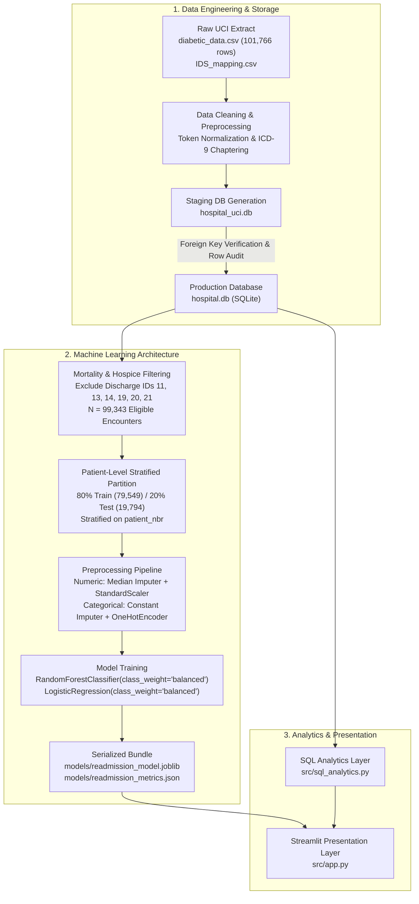

# Hospital Operations & Readmission Intelligence System

[](https://www.python.org/)
[](https://streamlit.io/)
[](https://www.sqlite.org/)
[](https://scikit-learn.org/)
[](https://plotly.com/)
[](https://opensource.org/licenses/MIT)

---

## 1. Brief Summary

The **Hospital Operations & Readmission Intelligence System** is an end-to-end healthcare data analytics platform and supervised machine learning system. It pairs real-time SQL operational census tracking with predictive risk scoring to detect inpatient **30-day all-cause hospital readmissions**. 

Built upon the historical **UCI Diabetes 130-US Hospitals (1999–2008)** dataset (101,766 inpatient encounters across 71,518 unique patients), the platform models clinical resource consumption, diagnoses, and medication regimens to generate actionable insights and patient-level risk probabilities through an interactive Streamlit application.

> **⚠️ Clinical & Educational Disclaimer:** This software is an educational and analytical portfolio prototype. It is **not** a certified medical device, clinical diagnostic aid, or clinical decision-support system. It must not be used to guide medical treatment, clinical diagnoses, or direct patient care decisions.

---

## 2. Project Overview

Unplanned hospital readmissions are a critical indicator of healthcare quality and post-discharge coordination. This project delivers an enterprise-grade analytics solution bridging clinical data engineering, relational SQL analytics, and supervised machine learning:

1. **Relational Data Pipeline:** Normalizes raw hospital encounter tables, maps ICD-9 diagnostic codes into epidemiological chapters, and stages verified data into SQLite with foreign key validation.
2. **Operational Intelligence Engine:** Computes census distributions, length of stay (LOS), admission dynamics, and clinical utilization patterns using parameterized SQL aggregate queries.
3. **Predictive Risk Scoring Pipeline:** Employs a leakage-free Scikit-learn Random Forest classifier with balanced class weighting to estimate 30-day readmission risk for clinical triage.
4. **Interactive SaaS Dashboard:** Renders operational KPIs, cohort distributions, tabular encounter explorers, and an interactive risk scoring calculator using Streamlit and Plotly.

---

## 3. Problem Statement

Under the Centers for Medicare & Medicaid Services (CMS) **Hospital Readmissions Reduction Program (HRRP)**, acute care hospitals face substantial financial penalties if their 30-day unplanned readmission rates exceed national benchmarks. In the United States, unplanned readmissions account for over **$17 billion** in annual Medicare expenditures.

Hospitals face two operational hurdles:
- **Operational Blind Spots:** Inpatient resource usage (medication volume, diagnostic lab procedures, length of stay) is rarely integrated with real-time census tracking across demographics and admission pathways.
- **Extreme Class Imbalance in Clinical Risk:** Early 30-day readmissions represent only **11.4%** of eligible inpatient discharges. Traditional unweighted machine learning models optimize for overall accuracy by predicting negative across the board, completely missing high-risk patients who require post-discharge intervention.

This system solves both challenges by combining comprehensive SQL operational visibility with an ML pipeline engineered specifically to prioritize **recall (sensitivity)** and **ROC-AUC** over misleading raw accuracy.

---

## 4. Dataset

The system is trained and evaluated on the official **Diabetes 130-US Hospitals for Years 1999–2008** dataset provided by the **UC Irvine Machine Learning Repository**.

- **Cohort Size:** 101,766 hospital encounters across 71,518 unique patients.
- **Facilities:** 130 clinical facilities across the United States.
- **Timeframe:** 10-year historical observation window (1999–2008).
- **Academic Citation:**  
  > Strack, B., DeShazo, J. P., Gennings, C., Olmo, J. L., Ventura, S., Cios, K. J., & Clore, J. N. (2014).  
  > *Impact of HbA1c Measurement on Hospital Readmission Rates: Analysis of 70,000 Clinical Database Patient Records.*  
  > BioMed Research International, 2014, 781670. DOI: [10.1155/2014/781670](https://doi.org/10.1155/2014/781670)

### Key Attributes
- **Target Variable (`readmitted`):**
  - `<30`: Unplanned readmission within 30 days (**11,357 encounters ~ 11.16%**).
  - `>30`: Readmission after 30 days (**35,545 encounters ~ 34.93%**).
  - `NO`: No readmission recorded (**54,866 encounters ~ 53.91%**).
- **Stay Duration:** Native `time_in_hospital` (1–14 days). *(Note: De-identified UCI records contain no calendar timestamps; the system strictly avoids synthesizing artificial dates).*
- **Clinical Intensity:** `num_lab_procedures` (1–132), `num_procedures` (0–6), `num_medications` (1–81), `number_diagnoses` (1–16).
- **Diagnostic Codes:** Three primary ICD-9 diagnosis codes (`diag_1`, `diag_2`, `diag_3`) categorized into 19 epidemiological chapters.
- **Medications & Glycemic Markers:** Regimens for 23 diabetes medications (including `insulin`), medication modifications (`change`), and HbA1c testing results (`A1Cresult`).

---

## 5. Tools & Technologies

| Layer | Technology | Version | Purpose & Implementation |
| :--- | :--- | :---: | :--- |
| **Language** | **Python** | `3.10+` | Core programming, data processing, and analytics logic |
| **Frontend / UI** | **Streamlit** | `>=1.32` | Multi-section clinical operations portal and risk calculator |
| **Database** | **SQLite 3** | Native | Indexed relational database for encounters, patients, and lookup tables |
| **Machine Learning** | **Scikit-learn** | `>=1.4` | `ColumnTransformer`, `Pipeline`, `RandomForestClassifier`, `LogisticRegression` |
| **Visualization** | **Plotly** | `>=5.18` | Interactive bar charts, demographic donuts, and clinical utilization distributions |
| **Data Engineering** | **Pandas** | `>=2.2` | High-performance vector operations, aggregation, and tabular filtering |
| **Numerical Ops** | **NumPy** | `>=1.26` | Array manipulation, matrix operations, and metric calculations |
| **Serialization** | **Joblib** | `>=1.3` | Model pipeline serialization and persistence (`models/readmission_model.joblib`) |
| **Version Control** | **Git / GitHub** | Latest | Strict exclusion rules (`.gitignore`) for local databases, caches, and environments |

---

## 6. Methods



### 1. Data Preparation & Cleaning
- **Token Cleaning:** Maps missing tokens (`?`, `None`, `Null`) to standardized labels or median statistics.
- **ICD-9 Chaptering:** Groups hundreds of granular ICD-9 codes into 19 standard clinical categories (Circulatory, Respiratory, Digestive, Diabetes, Injury, Genitourinary, Neoplasms, etc.) based on established epidemiological literature.

### 2. Modeling Hygiene & Data Leakage Prevention
- **Target Formulation:** Binary target `readmission_30d = 1` if `readmitted == "<30"`, and `0` otherwise (`>30` or `NO`).
- **Feature Exclusion:** Outcome indicators (`readmitted`), internal keys (`encounter_id`), and patient tracking IDs (`patient_nbr`) are strictly omitted from feature matrices.
- **Mortality/Hospice Exclusion:** Encounters with discharge dispositions corresponding to expiration or hospice care (**2,423 encounters**) are pruned prior to modeling, leaving **99,343 eligible encounters**.
- **Grouped Patient-Level Holdout Split:** Encounters are split **80% train (79,549)** and **20% test (19,794)** grouped by `patient_nbr`. All encounters from any individual patient reside entirely in either the train or test set, preventing multi-visit data leakage.

### 3. Pipeline Architecture
Features are processed through a unified Scikit-learn `ColumnTransformer`:
- **8 Numeric Features:** `time_in_hospital`, `num_lab_procedures`, `num_procedures`, `num_medications`, `number_outpatient`, `number_emergency`, `number_inpatient`, `number_diagnoses` (processed via `SimpleImputer(strategy="median")` and `StandardScaler()`).
- **14 Categorical Features:** `age`, `gender`, `race`, `admission_type`, `admission_source`, `discharge_disposition`, `payer_code`, `medical_specialty`, `insulin`, `change`, `diabetesMed`, `A1Cresult`, `max_glu_serum`, `diag_1_group` (processed via `SimpleImputer(strategy="constant", fill_value="Unknown")` and `OneHotEncoder(handle_unknown="ignore")`).
- **Imbalance Mitigation:** Configured with `class_weight="balanced"` to counteract the 11.4% positive prevalence and penalize false negatives.

---

## 7. Key Insights

Analysis of the 101,766 hospital encounters yielded the following validated operational insights:

1. **Medication Volume Directly Correlates with Readmission:**
   - Patients readmitted within 30 days were prescribed an average of **16.90 medications**, compared to **15.67** for patients with no recorded readmissions.
2. **Elevated Diagnostic Procedure Intensity:**
   - Encounters resulting in early readmission underwent higher diagnostic lab testing (**44.23 mean lab tests**) versus non-readmitted encounters (**42.38 mean lab tests**).
3. **Emergency Influx Dominance:**
   - Over **53.1%** of all admissions originate from the Emergency Department (53,992 encounters), followed by Elective (18,869) and Urgent (18,480) admissions.
4. **Bimodal Readmission Risk by Age:**
   - 30-day readmission rates peak in the young adult cohort (**20–30 years: 14.24%**) and the geriatric population (**80–90 years: 12.08%**), compared to an overall baseline of **11.16%**.
5. **Primary Diagnostic Drivers:**
   - **Circulatory diseases** constitute the largest diagnostic chapter (**30,437 encounters ~ 29.9%**), followed by **Respiratory conditions** (**14,423 encounters ~ 14.2%**) and **Digestive disorders** (**9,475 encounters ~ 9.3%**).

---

## 8. Dashboard & Model Outputs

The interactive Streamlit dashboard is organized into six functional operational views:

| View | Purpose & Interactive Capabilities |
| :--- | :--- |
| **📊 Executive Overview** | High-level clinical KPI cards (Patients, Encounters, Avg LOS, 30-Day Rate, Medications, Lab Tests) paired with admission source charts, gender share donuts, and readmission breakdown distributions. |
| **🏥 Operations & Census** | Three analytical tabs: **1.** Demographics & Origins; **2.** Clinical Utilization & Length of Stay across age tiers; **3.** Primary Diagnosis Groups ranked by ICD-9 volume. |
| **🔄 Readmission Analytics** | Readmission benchmark charts evaluating 30-day rates across age cohorts, admission pathways, medication intensity, and diagnosis chapters in the context of CMS HRRP guidelines. |
| **🔍 Encounter Explorer** | High-performance SQL table browser with multi-parameter sidebar filters (gender, age, race, admission type, payer, specialty, readmission status), search by ID, and one-click CSV export. |
| **🤖 30-Day Risk Scorer** | Interactive real-time risk assessment tool. Allows selecting pre-built clinical archetypes (e.g. *High-Risk Geriatric*, *Typical Diabetes Inpatient*, *Low-Risk Elective*) or customizing 22 clinical variables to calculate risk probability, risk category, and relative risk multipliers. |
| **➕ Demo Encounter Entry** | Safe data management form allowing evaluators to insert prototype encounters marked with `record_source = 'demo_user'`, preserving historical UCI record integrity. |

---

## 9. How to Run

### Prerequisites
- Python 3.10, 3.11, or 3.12
- Git

### Step-by-Step Setup

```bash
# 1. Clone the repository
git clone https://github.com/your-username/hospital-operations-readmission-system.git
cd hospital-operations-readmission-system

# 2. Create and activate a virtual environment
# Windows (PowerShell)
python -m venv .venv
.venv\Scripts\Activate.ps1

# macOS / Linux
python3 -m venv .venv
source .venv/bin/activate

# 3. Upgrade pip and install dependencies
python -m pip install --upgrade pip
python -m pip install -r requirements.txt

# 4. Fetch the UCI dataset (if not present)
python scripts/download_uci.py

# 5. Build and index the SQLite database
python src/database.py

# 6. (Optional) Run CLI health check & verify KPIs
python src/analysis.py

# 7. (Optional) Retrain and evaluate ML models
python src/ml_risk.py

# 8. Launch the Streamlit application
streamlit run src/app.py
```
*(Alternatively, execute `streamlit run app.py` from the root directory).*

### Demo Access Credentials
When prompted at the Clinical Operations Portal:
- **Username:** `admin`
- **Password:** `hospital123`
- *(Or click the **⚡ Quick Fill Demo** button).*

---

## 10. Results & Conclusion

### Verified Held-Out Test Evaluation
Model performance evaluated strictly on **19,794 unseen test encounters** (13,998 unique patients, 2,193 positive readmission cases):

| Model | ROC-AUC | Recall (Sensitivity) | Precision | F1 Score | Overall Accuracy |
| :--- | :---: | :---: | :---: | :---: | :---: |
| **Random Forest (Active Pipeline)** | **0.666** | **60.2%** (1,321 / 2,193) | **17.1%** | **0.267** | **63.4%** |
| Logistic Regression (Baseline) | 0.658 | 54.8% (1,202 / 2,193) | 17.5% | 0.265 | 66.4% |
| Dummy Classifier (Stratified) | 0.500 | 11.0% | 11.1% | 0.111 | 80.3% |

### Confusion Matrix Breakdown (Random Forest on Held-Out Test Set)
- **True Negatives (TN):** `11,228` encounters correctly identified as safe / low risk.
- **False Positives (FP):** `6,373` encounters flagged for preventative review.
- **False Negatives (FN):** `872` readmissions missed.
- **True Positives (TP):** `1,321` early readmissions captured.

### Operational Interpretation
In healthcare risk stratification, **Recall is the critical operational metric**. An unweighted model achieving 88% accuracy by predicting zero readmissions provides zero clinical utility. By setting balanced class weights, the Random Forest model captures **over 60.2% of all 30-day readmissions**, allowing discharge planners to focus high-touch post-discharge interventions on high-risk patients.

---

## 11. Future Work

- **SHAP / TreeExplainer Interpretability:** Integrate Shapley additive explanations directly into the Streamlit UI to display per-patient risk contribution waterfalls.
- **Cost-Sensitive Threshold Tuning:** Implement custom decision thresholds tied to hospital bed penalty economics ($/false positive transition call vs $/false negative penalty).
- **FHIR / HL7 Integration:** Build ingestion connectors to parse real-time Fast Healthcare Interoperability Resources (FHIR) bundles from hospital EHR systems.
- **Longitudinal Patient Trajectories:** Model multi-encounter time-decay series using recurrent or survival analysis approaches for chronic recurrent admissions.

---

## 12. Author & Contact

Developed as an applied data science and healthcare analytics portfolio project.

- **Author:** Farhat Shaikh
- **Role:** B.E CSE (AI & ML) Student
- **GitHub:** https://github.com/BitFarhat
- **LinkedIn:** https://www.linkedin.com/in/farhat-shaikh-252a34344
- **Email:** shaikhfarhat.1109@gmail.com

---

## 13. License & Acknowledgments

- **License:** Released under the [MIT License](https://opensource.org/licenses/MIT).
- **Dataset Attribution:** The Diabetes 130-US Hospitals dataset is hosted by the [UC Irvine Machine Learning Repository](https://archive.ics.uci.edu/dataset/296/diabetes%2B130-us%2Bhospitals%2Bfor%2Byears%2B1999-2008) under CC BY 4.0.
